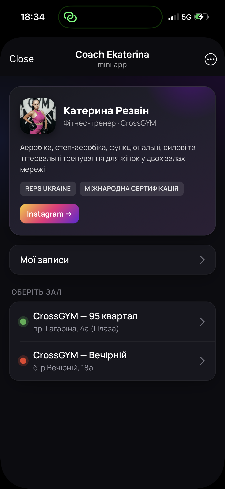
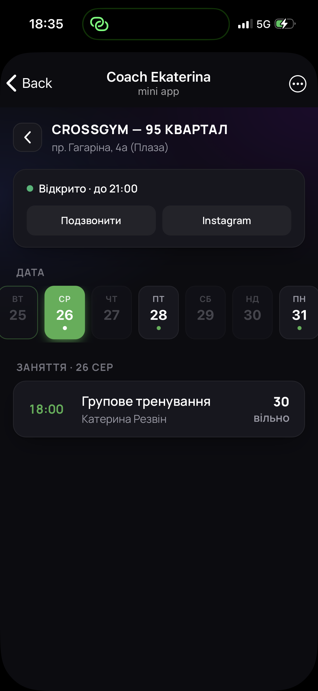
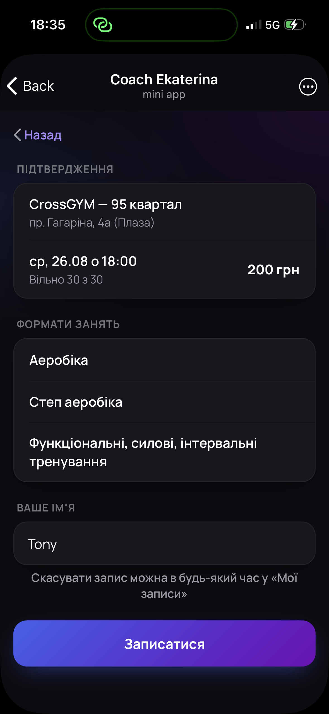

# CrossGYM Trainer Booking — Telegram Mini App

Live booking system for a CrossFit trainer's group sessions across two clubs in Kryvyi Rih.
Members book inside Telegram; the trainer manages the schedule from an admin view in the
same app. In daily use since September 2026.

<p align="center">
  
  
  
</p>

## Features

- Browse clubs with live open/closed status from each location's working hours
- Book a session; booking limits and cancellation rules enforced server-side
- "My bookings" view, cancel any time
- Admin view gated by Telegram user ID
- State persists across reopens via Telegram CloudStorage, localStorage as fallback

## Architecture

```
Telegram Mini App  ──►  n8n webhooks  ──►  Google Sheets
   (static JS)          booking · schedule       (datastore)
                        cancel · admin
```

Buildless frontend — static HTML/CSS/JS on the Telegram Web App SDK, no bundler. All
business logic sits in n8n workflows, so the trainer's rules (session limits, cancellation
windows, working hours) change without redeploying anything.

Workflow export: [`workflows/trainer-booking.json`](workflows/trainer-booking.json)
(credentials and the Google Sheet ID stripped).

## Notable problem: signature verification without `crypto`

Telegram signs the `initData` payload a Mini App receives, and the backend has to verify
it — otherwise anyone can call the booking webhook with a forged user ID and reach the
admin view. n8n's Code node is sandboxed and blocks Node's `crypto` module, so standard
HMAC-SHA256 verification wasn't available. I implemented SHA-256 and HMAC in plain
JavaScript inside the Code node, and validated it against 375+ reference test vectors
before it touched a real booking.

## Stack

Static HTML/CSS/JS · Telegram Web App SDK · n8n (self-hosted) · Google Sheets

## Structure

```
site/       index.html, style.css, app.js, screenshots/
workflows/  n8n export (credentials stripped)
```

Built by Danylo Radeiko — [GitHub](https://github.com/radei4ko) · radei4ko@gmail.com
